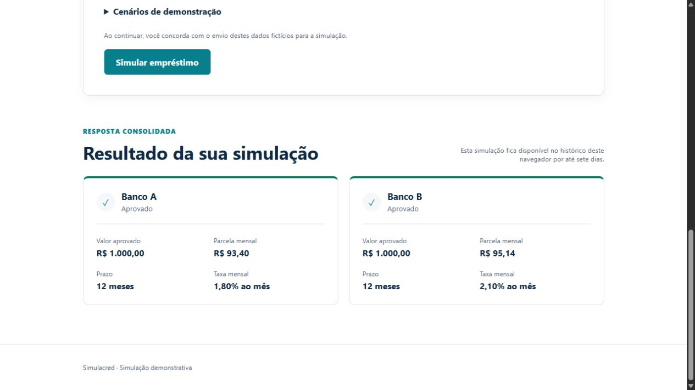
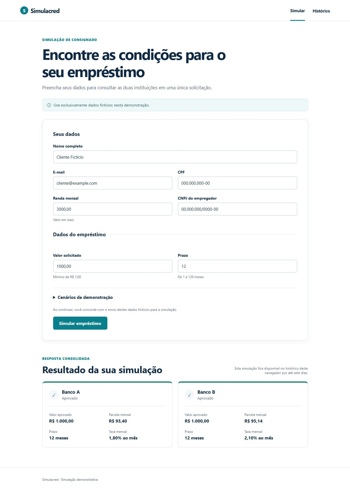
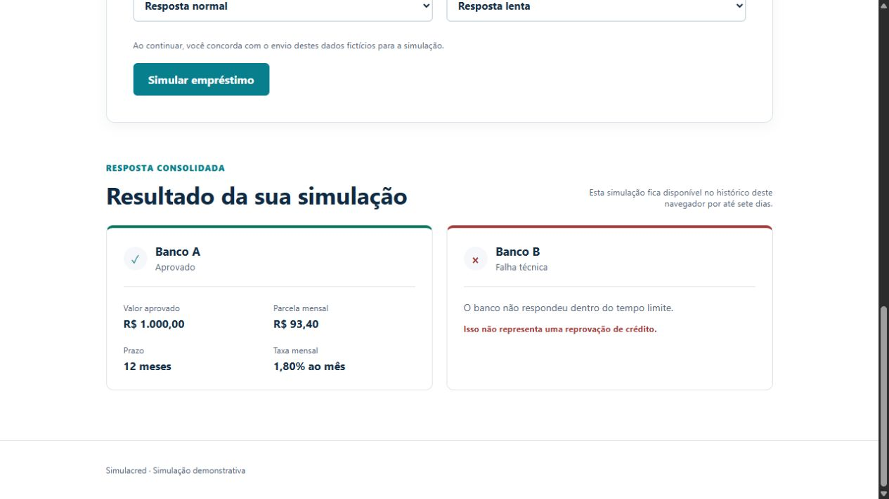
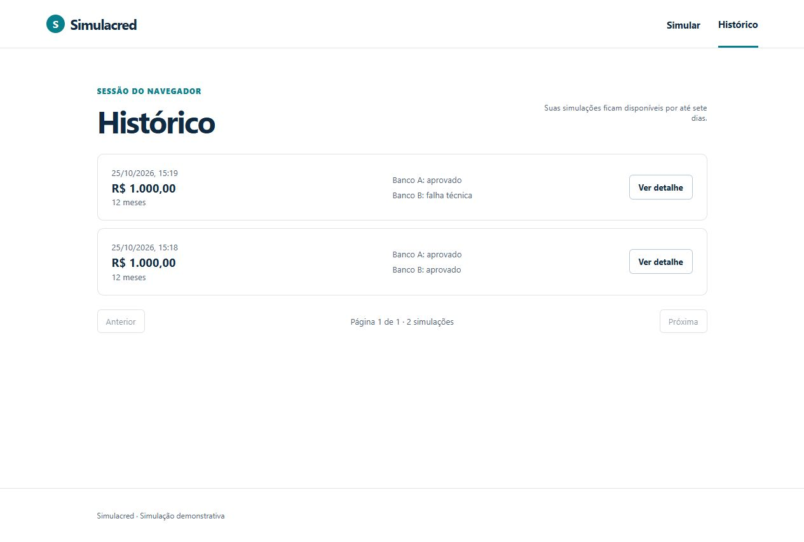
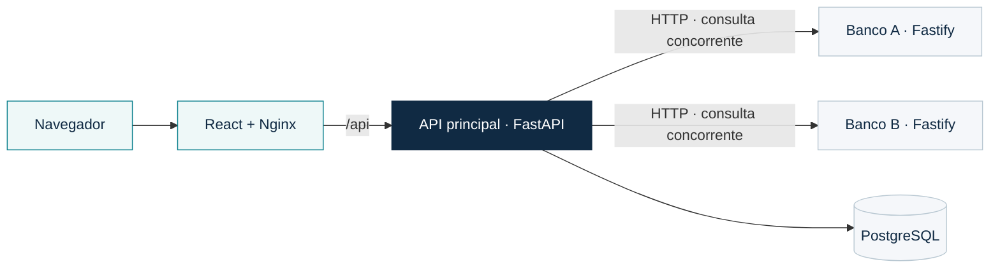
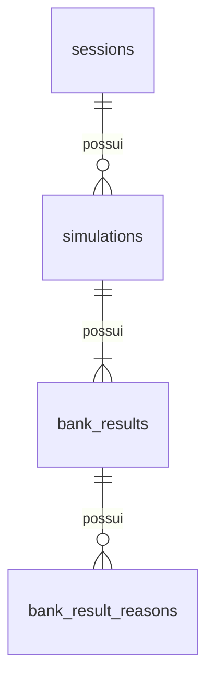

<p align="center">
  
</p>

<p align="center">
  Simulador de empréstimo consignado com consultas concorrentes,<br>
  tratamento de falhas e histórico sem cadastro.
</p>

<p align="center">
  
  
  
  
  
  <br>
  
  
  
  
</p>

<p align="center">
  <a href="#demonstracao">Demonstração</a> ·
  <a href="#executar">Como executar</a> ·
  <a href="#stack">Stack</a> ·
  <a href="#arquitetura">Arquitetura</a> ·
  <a href="#propostas">Propostas</a> ·
  <a href="#testes">Testes</a>
</p>

---

MVP desenvolvido para o desafio de estágio da **Octafin**. O cliente informa seus dados, recebe a avaliação individual de dois bancos fictícios e pode consultar ou excluir simulações no histórico do navegador.

O foco é integrar serviços externos com contratos diferentes e apresentar seus resultados de forma consistente, inclusive quando uma instituição demora ou fica indisponível.

> **Demonstração com dados fictícios.** Os bancos e suas políticas são simulados; a aplicação não representa uma oferta de crédito real.

| ↗ Consultas simultâneas | ↔ Falhas parciais | ◷ Histórico sem cadastro | ◇ Dados minimizados |
| :--- | :--- | :--- | :--- |
| Duas instituições consultadas na mesma solicitação. | A avaliação disponível é preservada quando outro banco falha. | Resultados salvos por até sete dias na sessão do navegador. | Identificação encaminhada aos bancos, sem persistência no histórico. |

<a id="demonstracao"></a>

## Demonstração

**Duas instituições, uma resposta consolidada.** As ofertas mostram valor, parcela, prazo e taxa mensal lado a lado.



<details>
<summary><strong>Ver a tela completa da simulação</strong></summary>



</details>

<details>
<summary><strong>Ver o tratamento de falha parcial e o histórico</strong></summary>

**Um banco respondeu; o outro excedeu o prazo.** A oferta disponível continua visível, e a falha técnica é apresentada separadamente de uma reprovação.



**Histórico do navegador.** As simulações salvas podem ser consultadas em detalhe ou excluídas, sem exigir cadastro.



</details>

As capturas mostram a aplicação executada em ambiente local descartável, utilizando somente dados fictícios.

## Funcionalidades

- Formulário com nome, e-mail, CPF, renda mensal, CNPJ do empregador, valor solicitado e prazo.
- Consulta simultânea a dois bancos por HTTP, com aprovação, motivos de reprovação ou falha técnica por instituição.
- Exibição de valor, prazo, taxa mensal e parcela nas ofertas aprovadas.
- Cenários independentes de funcionamento normal, lentidão e indisponibilidade para cada banco.
- Histórico paginado, detalhe e exclusão com confirmação, sem exigir cadastro.
- Persistência PostgreSQL, migrações e comando manual de limpeza de sessões expiradas.

<a id="executar"></a>

## Execução com Docker Compose

### Pré-requisitos

Docker com o daemon em execução e Docker Compose v2, com suporte a `--wait`. No Windows, utilize containers Linux. Não é necessário instalar Python ou Node.js para executar a aplicação por este caminho.

Na raiz do repositório, copie a configuração de exemplo, caso ainda não tenha um `.env`:

```powershell
Copy-Item .env.example .env
```

No Linux/macOS, use `cp .env.example .env`. O arquivo contém credenciais fictícias para desenvolvimento local. Depois, execute:

```powershell
docker compose up --build -d --wait
```

O Compose inicia PostgreSQL e as mocks, aplica `alembic upgrade head` pelo serviço `migrate` e inicia a API e o frontend. O serviço de migração terminar com código zero é o comportamento esperado.

| Serviço | Endereço padrão |
| --- | --- |
| Aplicação | [localhost:5173](http://localhost:5173) |
| Documentação interativa da API | [localhost:8000/docs](http://localhost:8000/docs) |
| OpenAPI | [localhost:8000/openapi.json](http://localhost:8000/openapi.json) |
| Health do Banco A | [localhost:3001/health](http://localhost:3001/health) |
| Health do Banco B | [localhost:3002/health](http://localhost:3002/health) |
| PostgreSQL | `localhost:5432` |

As portas são publicadas apenas em `127.0.0.1`. Abra a aplicação usando `localhost`, conforme as origens do exemplo. Se mudar o host ou as portas da interface/API, ajuste também `ALLOWED_ORIGINS`; `http://127.0.0.1:5173` é uma origem diferente de `http://localhost:5173`.

Para inspecionar ou encerrar:

```powershell
docker compose ps -a
docker compose logs --tail=100 credit-simulation-api migrate frontend
docker compose down
```

`down` preserva o volume do PostgreSQL. As credenciais `POSTGRES_*` inicializam um volume novo; alterá-las no `.env` não reconfigura um banco já existente. Para apagar todos os dados locais e reiniciar o banco, use **`docker compose down --volumes`**.

<details>
<summary><strong>Configuração de ambiente e proxy do frontend</strong></summary>

O arquivo `.env.example` da raiz documenta as variáveis utilizadas:

| Variáveis | Finalidade |
| --- | --- |
| `POSTGRES_USER`, `POSTGRES_PASSWORD`, `POSTGRES_DB` | Credenciais e banco de desenvolvimento |
| `POSTGRES_HOST`, `POSTGRES_PORT` | Acesso ao PostgreSQL pela API local; no Compose, host e porta internos são definidos automaticamente |
| `BANK_A_BASE_URL`, `BANK_B_BASE_URL` | Endereços das mocks para execução da API na máquina; o Compose usa os nomes internos dos serviços |
| `BANK_TIMEOUT_SECONDS` | Prazo total de comunicação por banco; padrão de 5 segundos |
| `CREDIT_API_PORT`, `BANK_A_PORT`, `BANK_B_PORT`, `FRONTEND_PORT` | Portas publicadas pelo Compose |
| `ALLOWED_ORIGINS` | Lista JSON de origens explícitas autorizadas, usada na proteção de escrita e no CORS |
| `SESSION_COOKIE_SECURE` | `false` no HTTP local; deve ser `true` ao servir por HTTPS |

O frontend no Compose usa `VITE_API_BASE_URL=/`, incorporado durante o build. O Nginx serve os arquivos estáticos e encaminha `/api` para a API, mantendo uma origem única no navegador. Variáveis `VITE_*` exigem novo build para alterar o JavaScript servido.

</details>

## Como demonstrar

1. Acesse a aplicação e preencha o formulário com os dados fictícios abaixo.
2. Envie a simulação para visualizar as duas ofertas.
3. Abra **Cenários de demonstração** e altere os cenários de cada banco para observar falhas parciais ou totais.
4. Acesse **Histórico**, abra o detalhe e experimente excluir um registro.

| Campo | Exemplo |
| --- | --- |
| Nome | Cliente Fictício |
| E-mail | cliente@example.com |
| CPF | 00000000000 |
| Renda mensal | R$ 3.000,00 |
| CNPJ do empregador | 00000000000000 |
| Valor solicitado | R$ 1.000,00 |
| Prazo | 12 meses |

Com esses dados e o timeout padrão, os comportamentos esperados são:

| Cenário A / B | Resultado |
| --- | --- |
| Normal / Normal | Ambos aprovados; parcelas de R$ 93,40 e R$ 95,14, respectivamente |
| Normal / Lento | A aprovado; B com falha `TIMEOUT` |
| Lento / Normal | Ambos aprovados; A tem atraso artificial de 3 segundos |
| Normal / Indisponível | A aprovado; B com falha `BANK_UNAVAILABLE` |
| Indisponível / Indisponível | Duas falhas técnicas, com a simulação salva no histórico |

O cenário lento do Banco B demora 8 segundos, ultrapassando o limite padrão de 5 segundos. Para demonstrar reprovação de crédito, use os cenários normais e reduza a renda para R$ 1.000,00.

<details>
<summary><strong>Políticas fictícias do Banco A e do Banco B</strong></summary>

| Critério | Banco A | Banco B |
| --- | --- | --- |
| Renda mínima | R$ 1.500,00 | R$ 2.000,00 |
| Valor máximo | R$ 50.000,00 | R$ 30.000,00 |
| Prazo aceito | 6 a 48 meses | 12 a 60 meses |
| Taxa mensal fixa | 1,80% | 2,10% |
| Parcela máxima sobre a renda | 30% | 25% |

As regras são determinísticas e pertencem às mocks. CPF e CNPJ validam somente quantidade e formato dos dígitos, sem verificar dígitos verificadores. O cálculo estima parcelas fixas, sem IOF, seguros, tarifas, CET ou ajuste da última parcela; não representa uma oferta bancária real.

</details>

<a id="stack"></a>

## Stack

| Componente | Tecnologias e motivo da escolha |
| --- | --- |
| `frontend/` | React, TypeScript e Vite; componentes e estado local para formulário, resultados e histórico, com CSS e fetch sem bibliotecas adicionais de estado ou HTTP |
| `credit-simulation-api/` | Python 3.12+, FastAPI, Pydantic e HTTPX; stack escolhida para validação dos contratos e coordenação assíncrona das integrações |
| `bank-a-mock-api/` e `bank-b-mock-api/` | TypeScript, Fastify e TypeBox; serviços independentes para praticar TypeScript e representar contratos bancários distintos |
| Persistência | PostgreSQL 17, SQLAlchemy assíncrono, asyncpg e Alembic; histórico relacional com constraints e evolução versionada do esquema |
| Execução conjunta | Dockerfiles e Compose; ambiente local reproduzível com migração antes da API e build estático servido por Nginx |

<a id="arquitetura"></a>

## Arquitetura e decisões técnicas



**Separação de responsabilidades.** Routers tratam HTTP; schemas validam os dados; services coordenam operações e transações; repositories concentram consultas; adapters traduzem a integração externa. Não há CRUD genérico ou infraestrutura de filas para o fluxo síncrono deste MVP.

**Adapter por banco.** O Banco A recebe campos em camelCase e responde com `approved`; o Banco B recebe `applicant`/`loan` e responde com `decision.code`. Os adapters implementam o contrato comum `BankAdapter`, validam a resposta externa e produzem `approved`, `rejected` ou `failed`. Assim, a interface e a coordenação não dependem dos formatos bancários, e HTTP 200 com conteúdo inválido não é tratado como aprovação.

**Concorrência e falhas parciais.** `asyncio.TaskGroup` consulta os bancos simultaneamente. Cada consulta possui prazo total de comunicação configurável, incluindo leitura do corpo, sem retry automático. Uma falha esperada vira resultado individual e preserva a avaliação do outro banco. Esse prazo não limita a duração total do endpoint, que também valida e persiste dados.

**Persistência antes do sucesso.** As chamadas externas ocorrem fora da transação de gravação. Depois, sessão, simulação, resultados e motivos são salvos atomicamente. A API só retorna `201` após commit; se não puder salvar, retorna `503 / SIMULATION_SAVE_FAILED`. Mesmo duas falhas bancárias podem compor uma simulação salva com sucesso.

**Unidades explícitas.** Dinheiro trafega e é armazenado em centavos inteiros de BRL; taxas mensais usam pontos-base (`180 bps = 1,80%`). Isso evita usar valores monetários fracionários no contrato. A apresentação tem uma limitação conhecida em valores extremos, descrita adiante.

<details>
<summary><strong>Modelagem de dados, sessão e segurança HTTP</strong></summary>

O armazenamento possui quatro tabelas:



Cada simulação salva tem exatamente dois resultados, um por banco, garantidos pelo service; uma restrição única impede duplicar o mesmo banco na simulação. Chaves estrangeiras obrigatórias impedem filhos sem proprietário, e exclusões em cascata removem resultados e motivos. Motivos ficam em tabela própria, com código, mensagem e posição, permitindo constraints e preservação da ordem sem um documento JSONB opaco.

Somente renda mensal, valor solicitado e prazo são conservados da entrada, além dos resultados normalizados, IDs, datas e vínculo com a sessão. Nome, e-mail, CPF e CNPJ são validados e encaminhados aos bancos, sem persistência desses campos ou de respostas bancárias brutas. Os dados financeiros contextualizam a avaliação; a identificação não é necessária para consultar esse histórico. Essa minimização não torna os registros anônimos.

O histórico usa uma sessão anônima de **sete dias contados da criação**, sem renovação a cada simulação. O cookie `credit_session` contém um token aleatório; o banco armazena somente seu hash SHA-256. O cookie é HttpOnly, SameSite=Lax, restrito a `/api`, com Secure configurável. O acesso ao registro exige a sessão proprietária válida; conhecer o UUID não concede acesso.

POST e DELETE exigem um `Origin` explicitamente permitido, e o CORS usa a mesma lista com credenciais. Erros públicos possuem mensagens controladas e a validação não repete os dados pessoais recebidos.

</details>

<a id="propostas"></a>

## Propostas implementadas

### 1. Resiliência na consulta aos bancos

**Problema:** uma instituição lenta ou indisponível pode atrasar a solicitação e impedir o cliente de aproveitar a avaliação da outra.

**Proposta:** consultar simultaneamente, limitar a espera por banco e preservar resultados disponíveis, distinguindo falha técnica de reprovação. Cenários independentes nas mocks permitem demonstrar e testar esses comportamentos.

**Por quê:** reduz a espera acumulada e entrega uma avaliação útil mesmo com indisponibilidade parcial, sem comunicar uma reprovação que não aconteceu.

### 2. Histórico sem exigir cadastro

**Problema:** rever condições anteriores não deveria exigir preencher novamente o formulário nem executar outra avaliação.

**Proposta:** persistir simulações e oferecer listagem, detalhe e exclusão por sessão anônima persistente.

**Por quê:** permite consultar os resultados anteriores com acesso simples, sem acrescentar cadastro e login ao MVP.

### 3. Minimização e retenção dos dados

**Problema:** a integração exige identificação, mas conservá-la no histórico aumenta a exposição sem benefício para essa funcionalidade.

**Proposta:** não persistir nome, e-mail, CPF ou CNPJ; conservar os dados financeiros necessários, restringir o histórico à sessão e disponibilizar limpeza de sessões expiradas.

**Por quê:** reduz a informação conservada e mantém o contexto da avaliação. A expiração bloqueia o acesso; a remoção física depende do comando manual existente:

```powershell
docker compose --profile maintenance run --rm cleanup
```

Execute na raiz, com a imagem da API já construída e o banco disponível. O comando remove sessões expiradas e seus registros associados, preservando sessões válidas. Não é executado automaticamente pelo `up`.

## Propostas planejadas — prioridade para mais uma semana

### 1. Automatizar a limpeza dos registros expirados

**Problema:** o acesso expira, mas a remoção física depende de intervenção manual.

**Proposta:** agendar a execução do comando de limpeza já implementado.

**Por quê:** torna a remoção recorrente e reduz a dependência de uma pessoa lembrar de executar a manutenção.

### 2. Recuperar o histórico entre dispositivos

**Problema:** trocar de navegador ou perder o cookie impede recuperar o histórico anterior.

**Proposta:** definir e implementar identificação e recuperação que permitam consultar o histórico em outros dispositivos.

**Por quê:** oferece continuidade de acesso, exigindo definir cuidadosamente como comprovar a identidade e recuperar a credencial.

## API

A documentação interativa em `/docs` apresenta os schemas e respostas. As operações públicas são:

| Método | Rota | Resultado |
| --- | --- | --- |
| POST | `/api/simulations` | Cria e salva uma simulação; `201` |
| GET | `/api/simulations?page=1&page_size=10` | Lista o histórico da sessão; `200` |
| GET | `/api/simulations/{id}` | Retorna o detalhe salvo, sem consultar bancos novamente; `200` |
| DELETE | `/api/simulations/{id}` | Exclui a simulação da sessão; `204`, sem corpo |

<details>
<summary><strong>Exemplo de requisição JSON</strong></summary>

Exemplo de corpo do POST, também utilizável em **Try it out** na documentação local:

```json
{
  "name": "Cliente Fictício",
  "email": "cliente@example.com",
  "cpf": "00000000000",
  "monthly_income_cents": 300000,
  "employer_cnpj": "00000000000000",
  "requested_amount_cents": 100000,
  "term_months": 12
}
```

</details>

Todos os campos são obrigatórios; campos extras são rejeitados. O prazo estrutural é de 1 a 120 meses, a renda começa em 1 centavo e o valor solicitado em 100 centavos. Os valores monetários aceitam até `9007199254740991` centavos. Os bancos podem reprovar entradas estruturalmente válidas conforme suas políticas.

Para selecionar cenários, acrescente `?bank_a_scenario=normal&bank_b_scenario=slow` ao POST. As opções são `normal`, `slow` e `unavailable`, com padrão `normal` para cada banco. Clientes de terminal devem enviar `Origin: http://localhost:8000` nas escritas e conservar/enviar o cookie para acessar o mesmo histórico.

A resposta contém `id`, `created_at` em UTC e `results` na ordem A/B. Aprovação inclui `offer`; reprovação inclui `reasons`; falha técnica inclui `error`, com `TIMEOUT`, `BANK_UNAVAILABLE` ou `INVALID_BANK_RESPONSE`. Falha técnica não significa reprovação de crédito.

Histórico sem sessão válida retorna lista vazia, sem criar sessão. Detalhe ou exclusão de registro inacessível retorna `404 / SIMULATION_NOT_FOUND`, sem revelar a existência de registros alheios. Entrada inválida retorna `422`; escrita com origem proibida retorna `403`; falhas de persistência conhecidas retornam `503` com envelope `error: { code, message }`.

## Desenvolvimento local

<details>
<summary><strong>Executar e desenvolver cada componente fora dos containers de aplicação</strong></summary>

Para desenvolver fora dos containers de aplicação, utilize Node.js 24, Python 3.12+ e uv. Execute os comandos de cada componente em seu diretório; mantenha terminais separados para os servidores.

Na raiz, configure o `.env` e inicie as dependências:

```powershell
docker compose up -d postgres bank-a-mock-api bank-b-mock-api
```

Em `credit-simulation-api/`, a configuração lê o `.env` da raiz:

```powershell
uv sync --locked
uv run alembic upgrade head
uv run uvicorn app.main:app --reload --port 8000
```

Em `frontend/`:

```powershell
Copy-Item .env.example .env
npm ci
npm run dev -- --port 5173 --strictPort
```

O exemplo do frontend aponta para `http://localhost:8000`. Para desenvolver uma mock localmente, libere sua porta no Compose e, no diretório correspondente, execute `npm ci` e `npm run dev`. As mocks leem `HOST` e `PORT` do ambiente do processo; não carregam `.env` automaticamente.

</details>

<a id="testes"></a>

## Testes e validações

Resultados da revisão registrada em **25/10/2026**, no commit **`8f70c06`**:

| Componente | Testes aprovados | Verificações adicionais registradas |
| :--- | ---: | :--- |
| API principal | **646** — 491 unitários e 155 de integração | Ruff e formatação |
| Banco A | **66** | Typecheck e build |
| Banco B | **63** | Typecheck e build |
| Frontend | **45** | Build e ESLint |

São resultados daquela revisão, não uma nova execução durante a reformulação deste README. A integração pelo Compose/Nginx foi verificada por HTTP em etapa anterior; não há suíte permanente de navegador.

<details>
<summary><strong>Comandos para executar as verificações</strong></summary>

Na API, após instalar as dependências:

```powershell
uv run pytest tests/unit -W error
uv run pytest --run-integration -q -W error
uv run ruff check app tests migrations
uv run ruff format --check app tests migrations
```

Os unitários não exigem Docker. A suíte com integração requer Docker/Compose e cria PostgreSQL e mocks descartáveis com Testcontainers, migrações reais e comunicação HTTP; não utiliza o banco ou volume de desenvolvimento.

Em cada mock, execute `npm ci` antes das verificações:

```powershell
npm run typecheck
npm test
npm run build
```

No frontend, após `npm ci`:

```powershell
npm test
npm run build
npm run lint
```

</details>

## Limitações conhecidas

- **Precisão na apresentação de valores extremos:** a formatação divide centavos por 100 usando `Number`. No máximo aceito, `9007199254740991` centavos, pode mostrar R$ 90.071.992.547.409,90 em vez de R$ 90.071.992.547.409,91. O achado afeta apresentação; não demonstrou alteração dos inteiros enviados ou persistidos. A correção está pendente.
- **Sessão vinculada ao navegador:** não comprova identidade nem oferece recuperação. Os sete dias pertencem à sessão, não a cada registro; perder o cookie impede recuperar o acesso e não antecipa a limpeza.
- **Reenvios e concorrência inicial:** não há idempotência. Reenviar pode criar outra simulação; perder a primeira resposta pode também perder o cookie. Primeiras criações simultâneas sem cookie podem gerar sessões distintas, ficando acessível o histórico da credencial que prevalecer no navegador.
- **Persistência e concorrência:** perda de conexão exatamente durante commit não foi reproduzida; uma resposta de falha não garante ausência de gravação. Total e itens da paginação vêm de consultas separadas, podendo divergir sob alterações concorrentes.
- **Escopo financeiro e integração:** bancos e regras são fictícios; não há contratação, ranking, APIs bancárias reais ou cálculo de CET. O resultado é consolidado em uma resposta, sem atualização individual em tempo real ou retries.
- **Operação e validação:** limpeza ainda manual; não há implantação remota, TLS configurado, rate limiting ou certificação de segurança/acessibilidade. O healthcheck da API sem cookie comprova resposta HTTP, mas não disponibilidade contínua do PostgreSQL. Os testes HTTP e jsdom não certificam políticas efetivas do navegador, e não houve auditoria exaustiva de todos os caminhos de log.

## Licença

MIT, conforme o arquivo [LICENSE](LICENSE).
